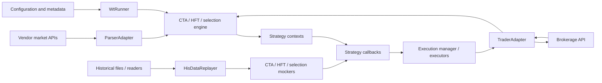
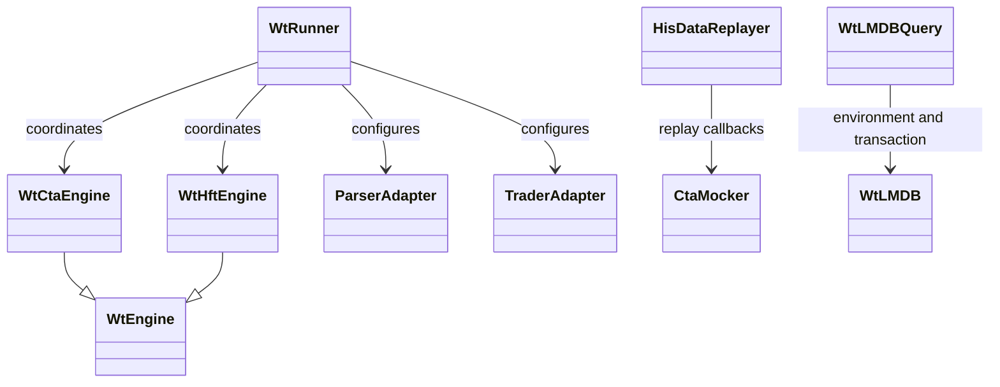
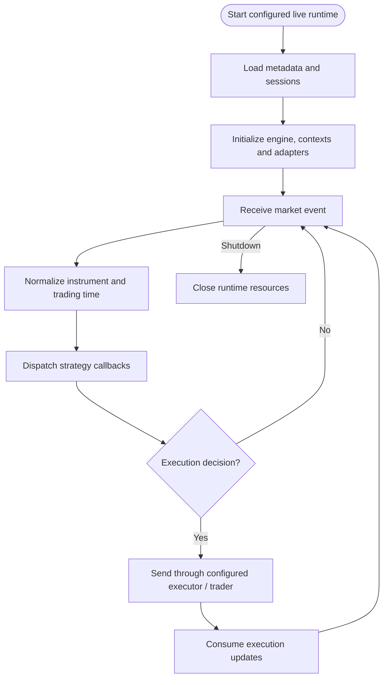
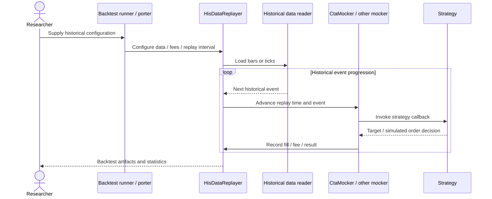
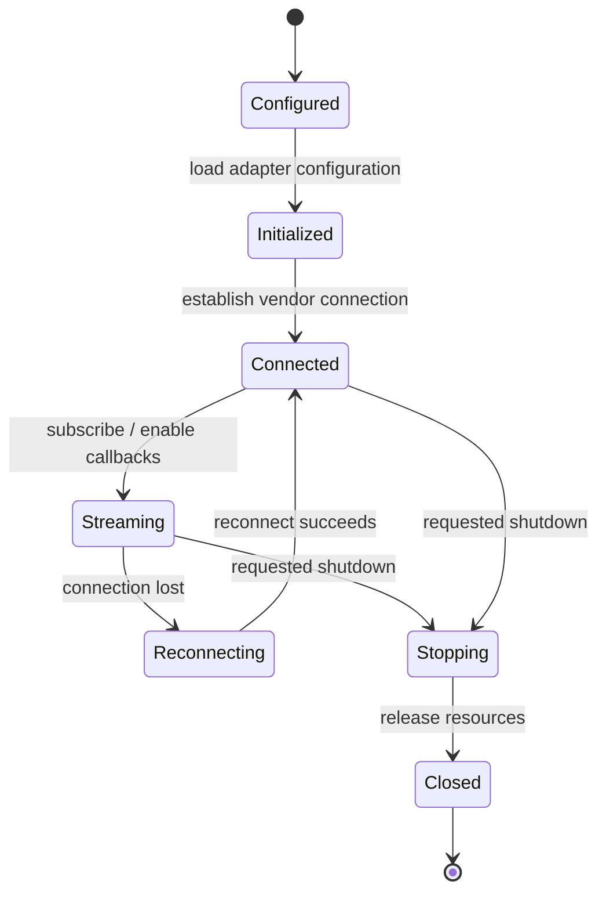

# WonderTrader: architecture, components, features and workflows

Updated: 2026-10-12 · Branch: `feature/ayu_develop`

[Development and layout](development.md) · [Validation evidence](validation.md) · [HTML edition](ayu-develop.html)

## Purpose

WonderTrader is a C++ trading framework with shared market models and separate live, backtest, data and execution runtimes. CTA, HFT and selection strategies interact with contexts. Market parsers and trader adapters isolate vendor APIs. A backtest replayer drives strategy mockers with historical events, while the live runner connects real parsers and execution adapters.

The repository contains the native core and porter libraries. Python-facing porter APIs are C ABI integration surfaces; the Python application packages themselves are maintained separately. A successful host build does not establish that every vendor brokerage SDK is available on the host platform.

## Features

- CTA, HFT and selection engines expose different strategy execution models.
- Historical replay supports tick/bar data and strategy mockers; fee templates include optional minimum fees for nonzero rate fills.
- Parser adapters normalize external market feeds into shared instrument/session/tick/bar representations.
- Trader adapters and local/distributed executors connect strategy targets to venue-specific execution.
- Data readers, writers and porter libraries provide independent data ingestion and storage responsibilities.
- LMDB and shared block helpers provide native persistence and interprocess integration.
- Strategy factories, engine interfaces and porter boundaries keep applications extensible without placing vendor behavior in the common model.

## Components and source ownership

| Component | Responsibility | Implementation |
| --- | --- | --- |
| Live coordinator | Loads configuration, factories and runtime engines | [WtRunner.h](../src/WtRunner/WtRunner.h), [WtRunner.cpp](../src/WtRunner/WtRunner.cpp) |
| CTA engine | Dispatches market/session events and strategy positions | [WtCtaEngine.h](../src/WtCore/WtCtaEngine.h), [WtCtaEngine.cpp](../src/WtCore/WtCtaEngine.cpp) |
| HFT engine | Owns the HFT execution/context path | [WtHftEngine.h](../src/WtCore/WtHftEngine.h) |
| Parser adapter | Bridges market API callbacks into the framework | [ParserAdapter.h](../src/WtCore/ParserAdapter.h), [ParserAdapter.cpp](../src/WtCore/ParserAdapter.cpp) |
| Trader adapter | Bridges account/order/trade API callbacks | [TraderAdapter.h](../src/WtCore/TraderAdapter.h) |
| Execution manager | Coordinates configured execution implementations | [WtExecMgr.h](../src/WtCore/WtExecMgr.h) |
| Historical replay | Loads historical data, advances replay and calculates fees | [HisDataReplayer.h](../src/WtBtCore/HisDataReplayer.h), [HisDataReplayer.cpp](../src/WtBtCore/HisDataReplayer.cpp) |
| CTA backtest context | Implements historical strategy callbacks and simulated results | [CtaMocker.h](../src/WtBtCore/CtaMocker.h) |
| Session model | Converts trading session times and recognizes boundaries | [WTSSessionInfo.hpp](../src/Includes/WTSSessionInfo.hpp) |
| LMDB wrapper | Manages database environments and transactional queries | [WtLMDB.hpp](../src/WTSUtils/WtLMDB.hpp) |
| Shared blocks | Maintains master/slave mapped sections and typed values | [ShareBlocks.h](../src/WtShareHelper/ShareBlocks.h), [ShareBlocks.cpp](../src/WtShareHelper/ShareBlocks.cpp) |
| Existing unit suite | Exercises formats, fee rules, sessions, LMDB and shared memory | [TestUnits/CMakeLists.txt](../src/TestUnits/CMakeLists.txt) |

## Architecture

Live and historical execution share models and strategy contracts, while their input/time/execution sources remain distinct.

The common models live under `src/Includes`; parser/trader integrations and strategy engines live under their native modules. `WtPorter`, `WtBtPorter`, `WtDtPorter` and `WtExecMon` expose integration-specific lifecycles. Data storage and transport do not replace strategy contexts or transaction semantics.

## Class relationships

The named classes exist in the linked headers. Inheritance is shown only where declared in source; other arrows indicate composition or operational interaction.

## Live workflow

1. Load configuration, contract metadata, calendars and trading sessions.
2. Construct engine and strategy contexts and register parser/trader integrations.
3. Receive feed callbacks and normalize instrument/time information.
4. Dispatch the event to the appropriate engine and strategy contexts.
5. Convert strategy targets or order decisions through the configured executor.
6. Receive order/trade/account updates through the trader adapter and publish state.

## Historical sequence

The replay workflow uses historical input and simulated strategy contexts. It does not route orders to a live brokerage.

## Adapter lifecycle

This diagram describes the intended lifecycle responsibilities of configured adapters. Vendor-specific states, login requirements and callback semantics are implemented by each adapter.

## Numerical and storage boundaries

Historical fees must preserve the distinction between zero-rate fills and nonzero fees subject to an optional minimum. The existing [fee tests](../src/TestUnits/test_replayer_fee.cpp) cover minimum fees and JSON templates. Session boundary conversions treat `0000` and `2400` as the same clock instant with different left/right alignment roles. The existing [session test](../src/TestUnits/test_session.cpp) exercises the full-day boundary.

LMDB environments need valid directories, POSIX permissions and a supported mapped filesystem. Unit validation uses the container's Linux filesystem because a host bind mount may have different locking semantics. Shared-memory tests now construct their own typed fixture instead of relying on a hardcoded Windows deployment file; the existing value assertions are preserved.

## Build and contribution workflow

```mermaid
flowchart LR
  Fetch[Fetch upstream branches / tags] --> Merge[Merge actual default into feature branch]
  Merge --> Toolchain[Select supported Linux native toolchain]
  Toolchain --> Dependencies[Load bundled vendor dependencies]
  Dependencies --> CMake[Configure CMake]
  CMake --> Build[Build all native targets]
  Build --> Units[Run existing TestUnits]
  Units --> Docs[Render diagrams / verify source links]
  Docs --> Commit[Commit verified source, docs and evidence]
```

The repository's bundled `docker/mydeps_gcc8.4.0.7z` and official Docker image provide the supported Linux dependency arrangement. GCC 8 requires `stdc++fs` for C++17 filesystem usage; the CMake target selects that library only for GNU versions earlier than 9. Native macOS configuration can be inspected, but Linux-only SDK/lib paths prevent claiming an equivalent macOS build.

Use the exact container commands and outcomes recorded in [validation.md](validation.md). Generated build outputs remain outside Git. Do not run example live runners as compilation checks: their behavior depends on the supplied venue configuration.
