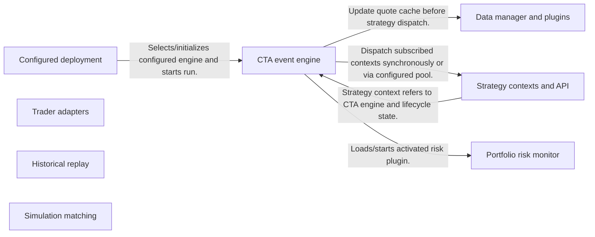
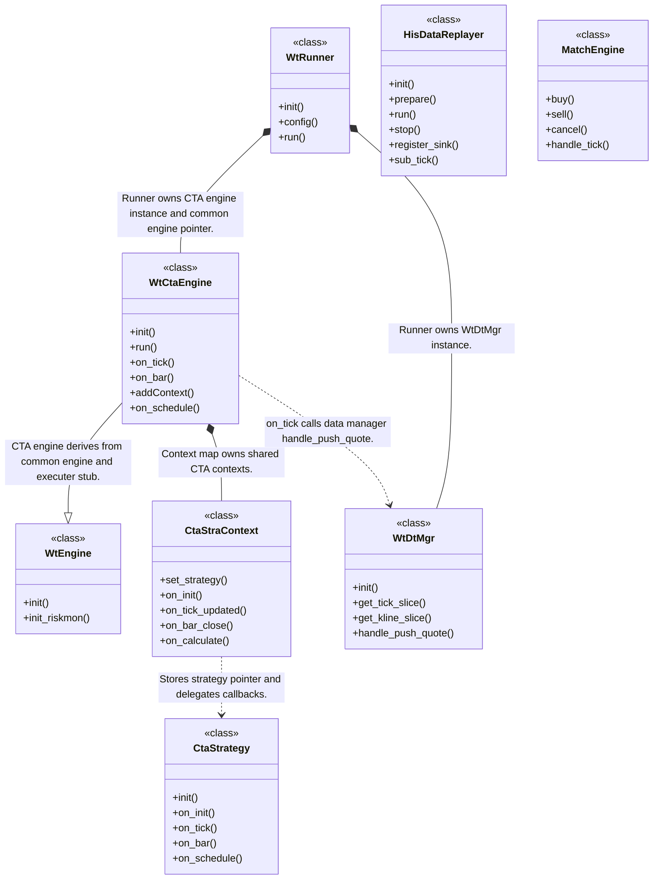
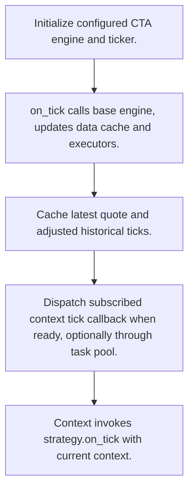
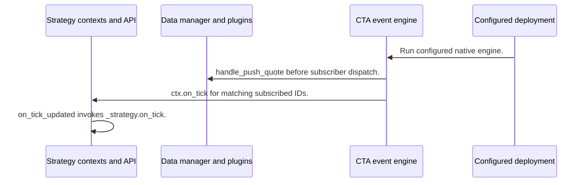

# WonderTrader: workflow, design and architecture

Updated: **2026-10-13**
Reviewed Git hash: `a9470813cedef7373bfe7e72ffeadf13d6484a75`
Branch: `feature/ayu_develop`
Source diff SHA256: `e3b0c44298fc1c149afbf4c8996fb92427ae41e4649b934ca495991b7852b855`
Scope: **Native strategy and execution platform** / Maintenance: **active**
Languages: C++

[HTML edition](ayu-develop.html) / [Development](development.md) / [Historical validation](validation.md) / [Full system comparison](../../docs/index.html)

## Purpose and scope

C++ CTA/HFT/selection runtime with strategy contexts, pluggable traders/parsers, historical replay, tick matching and portfolio risk-monitor plugins.

## Features and support boundaries

Native = implemented here. Integration = supplied through a named host/API. Limited = material restriction. Not provided = evidenced scope exclusion. Unverified = support/absence not established. Not applicable = outside this artifact type.

| Capability | Status | Implementation and limits | Source |
|---|---|---|---|
| Backtesting | Native | Historical replay sinks and plugin strategy callbacks are implemented alongside native event engine. | [HisDataReplayer](../src/WtBtCore/HisDataReplayer.h) ([L153](https://github.com/alexcwyu/wondertrader/blob/a9470813cedef7373bfe7e72ffeadf13d6484a75/src/WtBtCore/HisDataReplayer.h#L153)) / [run](../src/WtBtCore/HisDataReplayer.cpp) ([L675](https://github.com/alexcwyu/wondertrader/blob/a9470813cedef7373bfe7e72ffeadf13d6484a75/src/WtBtCore/HisDataReplayer.cpp#L675)) / [CtaStrategy](../src/Includes/CtaStrategyDefs.h) ([L26](https://github.com/alexcwyu/wondertrader/blob/a9470813cedef7373bfe7e72ffeadf13d6484a75/src/Includes/CtaStrategyDefs.h#L26)) / [on_tick](../src/WtCore/WtCtaEngine.cpp) ([L475](https://github.com/alexcwyu/wondertrader/blob/a9470813cedef7373bfe7e72ffeadf13d6484a75/src/WtCore/WtCtaEngine.cpp#L475)) |
| Live execution | Integration | Configured trader/parser runtime and tick dispatch support live SDK integration; source presence is not live credentials or production proof. | [WtRunner](../src/WtRunner/WtRunner.h) ([L41](https://github.com/alexcwyu/wondertrader/blob/a9470813cedef7373bfe7e72ffeadf13d6484a75/src/WtRunner/WtRunner.h#L41)) / [on_tick](../src/WtCore/WtCtaEngine.cpp) ([L475](https://github.com/alexcwyu/wondertrader/blob/a9470813cedef7373bfe7e72ffeadf13d6484a75/src/WtCore/WtCtaEngine.cpp#L475)) / [buy](../src/WtCore/TraderAdapter.cpp) ([L655](https://github.com/alexcwyu/wondertrader/blob/a9470813cedef7373bfe7e72ffeadf13d6484a75/src/WtCore/TraderAdapter.cpp#L655)) |
| Paper trading | Limited | Historical MatchEngine simulates orders/fills; separate live paper brokerage was not established by inspected runtime. | [MatchEngine](../src/WtBtCore/MatchEngine.h) ([L54](https://github.com/alexcwyu/wondertrader/blob/a9470813cedef7373bfe7e72ffeadf13d6484a75/src/WtBtCore/MatchEngine.h#L54)) / [handle_tick](../src/WtBtCore/MatchEngine.cpp) ([L340](https://github.com/alexcwyu/wondertrader/blob/a9470813cedef7373bfe7e72ffeadf13d6484a75/src/WtBtCore/MatchEngine.cpp#L340)) |
| Event driven | Native | Historical replay sinks and plugin strategy callbacks are implemented alongside native event engine. | [HisDataReplayer](../src/WtBtCore/HisDataReplayer.h) ([L153](https://github.com/alexcwyu/wondertrader/blob/a9470813cedef7373bfe7e72ffeadf13d6484a75/src/WtBtCore/HisDataReplayer.h#L153)) / [run](../src/WtBtCore/HisDataReplayer.cpp) ([L675](https://github.com/alexcwyu/wondertrader/blob/a9470813cedef7373bfe7e72ffeadf13d6484a75/src/WtBtCore/HisDataReplayer.cpp#L675)) / [CtaStrategy](../src/Includes/CtaStrategyDefs.h) ([L26](https://github.com/alexcwyu/wondertrader/blob/a9470813cedef7373bfe7e72ffeadf13d6484a75/src/Includes/CtaStrategyDefs.h#L26)) / [on_tick](../src/WtCore/WtCtaEngine.cpp) ([L475](https://github.com/alexcwyu/wondertrader/blob/a9470813cedef7373bfe7e72ffeadf13d6484a75/src/WtCore/WtCtaEngine.cpp#L475)) |
| Vectorized | Unverified | Not established by the inspected implementation boundaries; no absence or production claim is made. | Not applicable to this repository scope. |
| Order management | Native | Trader buy/sell/cancel and matching order activation/queue/trade callbacks exist; broad all-order-type claims are not inferred. | [buy](../src/WtCore/TraderAdapter.cpp) ([L655](https://github.com/alexcwyu/wondertrader/blob/a9470813cedef7373bfe7e72ffeadf13d6484a75/src/WtCore/TraderAdapter.cpp#L655)) / [handle_tick](../src/WtBtCore/MatchEngine.cpp) ([L340](https://github.com/alexcwyu/wondertrader/blob/a9470813cedef7373bfe7e72ffeadf13d6484a75/src/WtBtCore/MatchEngine.cpp#L340)) |
| Order types | Native | Trader buy/sell/cancel and matching order activation/queue/trade callbacks exist; broad all-order-type claims are not inferred. | [buy](../src/WtCore/TraderAdapter.cpp) ([L655](https://github.com/alexcwyu/wondertrader/blob/a9470813cedef7373bfe7e72ffeadf13d6484a75/src/WtCore/TraderAdapter.cpp#L655)) / [handle_tick](../src/WtBtCore/MatchEngine.cpp) ([L340](https://github.com/alexcwyu/wondertrader/blob/a9470813cedef7373bfe7e72ffeadf13d6484a75/src/WtBtCore/MatchEngine.cpp#L340)) |
| Multi venue | Unverified | Not established by the inspected implementation boundaries; no absence or production claim is made. | Not applicable to this repository scope. |
| Crypto | Unverified | Not established by the inspected implementation boundaries; no absence or production claim is made. | Not applicable to this repository scope. |
| Equities | Limited | Trader normalizes these contract categories and applies contract-specific action/session rules; live vendor/market availability is external. | [onPushTrade](../src/WtCore/TraderAdapter.cpp) ([L2134](https://github.com/alexcwyu/wondertrader/blob/a9470813cedef7373bfe7e72ffeadf13d6484a75/src/WtCore/TraderAdapter.cpp#L2134)) / [buy](../src/WtCore/TraderAdapter.cpp) ([L655](https://github.com/alexcwyu/wondertrader/blob/a9470813cedef7373bfe7e72ffeadf13d6484a75/src/WtCore/TraderAdapter.cpp#L655)) |
| Futures | Limited | Trader normalizes these contract categories and applies contract-specific action/session rules; live vendor/market availability is external. | [onPushTrade](../src/WtCore/TraderAdapter.cpp) ([L2134](https://github.com/alexcwyu/wondertrader/blob/a9470813cedef7373bfe7e72ffeadf13d6484a75/src/WtCore/TraderAdapter.cpp#L2134)) / [buy](../src/WtCore/TraderAdapter.cpp) ([L655](https://github.com/alexcwyu/wondertrader/blob/a9470813cedef7373bfe7e72ffeadf13d6484a75/src/WtCore/TraderAdapter.cpp#L655)) |
| Options | Limited | Trader normalizes these contract categories and applies contract-specific action/session rules; live vendor/market availability is external. | [onPushTrade](../src/WtCore/TraderAdapter.cpp) ([L2134](https://github.com/alexcwyu/wondertrader/blob/a9470813cedef7373bfe7e72ffeadf13d6484a75/src/WtCore/TraderAdapter.cpp#L2134)) / [buy](../src/WtCore/TraderAdapter.cpp) ([L655](https://github.com/alexcwyu/wondertrader/blob/a9470813cedef7373bfe7e72ffeadf13d6484a75/src/WtCore/TraderAdapter.cpp#L655)) |
| Forex | Unverified | Not established by the inspected implementation boundaries; no absence or production claim is made. | Not applicable to this repository scope. |
| Strategy api | Native | Historical replay sinks and plugin strategy callbacks are implemented alongside native event engine. | [HisDataReplayer](../src/WtBtCore/HisDataReplayer.h) ([L153](https://github.com/alexcwyu/wondertrader/blob/a9470813cedef7373bfe7e72ffeadf13d6484a75/src/WtBtCore/HisDataReplayer.h#L153)) / [run](../src/WtBtCore/HisDataReplayer.cpp) ([L675](https://github.com/alexcwyu/wondertrader/blob/a9470813cedef7373bfe7e72ffeadf13d6484a75/src/WtBtCore/HisDataReplayer.cpp#L675)) / [CtaStrategy](../src/Includes/CtaStrategyDefs.h) ([L26](https://github.com/alexcwyu/wondertrader/blob/a9470813cedef7373bfe7e72ffeadf13d6484a75/src/Includes/CtaStrategyDefs.h#L26)) / [on_tick](../src/WtCore/WtCtaEngine.cpp) ([L475](https://github.com/alexcwyu/wondertrader/blob/a9470813cedef7373bfe7e72ffeadf13d6484a75/src/WtCore/WtCtaEngine.cpp#L475)) |
| Optimization | Unverified | Not established by the inspected implementation boundaries; no absence or production claim is made. | Not applicable to this repository scope. |
| Machine learning | Unverified | Not established by the inspected implementation boundaries; no absence or production claim is made. | Not applicable to this repository scope. |
| Reinforcement learning | Unverified | Not established by the inspected implementation boundaries; no absence or production claim is made. | Not applicable to this repository scope. |
| Portfolio | Native | Risk monitor reads portfolio fund state and scales exposure on configured drawdown thresholds. | [run](../src/WtRiskMonFact/WtSimpRiskMon.cpp) ([L48](https://github.com/alexcwyu/wondertrader/blob/a9470813cedef7373bfe7e72ffeadf13d6484a75/src/WtRiskMonFact/WtSimpRiskMon.cpp#L48)) / [init_riskmon](../src/WtCore/WtEngine.cpp) ([L1120](https://github.com/alexcwyu/wondertrader/blob/a9470813cedef7373bfe7e72ffeadf13d6484a75/src/WtCore/WtEngine.cpp#L1120)) |
| Risk management | Native | Risk monitor reads portfolio fund state and scales exposure on configured drawdown thresholds. | [run](../src/WtRiskMonFact/WtSimpRiskMon.cpp) ([L48](https://github.com/alexcwyu/wondertrader/blob/a9470813cedef7373bfe7e72ffeadf13d6484a75/src/WtRiskMonFact/WtSimpRiskMon.cpp#L48)) / [init_riskmon](../src/WtCore/WtEngine.cpp) ([L1120](https://github.com/alexcwyu/wondertrader/blob/a9470813cedef7373bfe7e72ffeadf13d6484a75/src/WtCore/WtEngine.cpp#L1120)) |
| Performance analytics | Unverified | Not established by the inspected implementation boundaries; no absence or production claim is made. | Not applicable to this repository scope. |
| Historical data | Native | Data manager history slices and bar/tick/task replay pipeline are implemented. | [WtDtMgr](../src/WtCore/WtDtMgr.h) ([L27](https://github.com/alexcwyu/wondertrader/blob/a9470813cedef7373bfe7e72ffeadf13d6484a75/src/WtCore/WtDtMgr.h#L27)) / [HisDataReplayer](../src/WtBtCore/HisDataReplayer.h) ([L153](https://github.com/alexcwyu/wondertrader/blob/a9470813cedef7373bfe7e72ffeadf13d6484a75/src/WtBtCore/HisDataReplayer.h#L153)) / [run](../src/WtBtCore/HisDataReplayer.cpp) ([L675](https://github.com/alexcwyu/wondertrader/blob/a9470813cedef7373bfe7e72ffeadf13d6484a75/src/WtBtCore/HisDataReplayer.cpp#L675)) |
| Streaming data | Integration | Configured trader/parser runtime and tick dispatch support live SDK integration; source presence is not live credentials or production proof. | [WtRunner](../src/WtRunner/WtRunner.h) ([L41](https://github.com/alexcwyu/wondertrader/blob/a9470813cedef7373bfe7e72ffeadf13d6484a75/src/WtRunner/WtRunner.h#L41)) / [on_tick](../src/WtCore/WtCtaEngine.cpp) ([L475](https://github.com/alexcwyu/wondertrader/blob/a9470813cedef7373bfe7e72ffeadf13d6484a75/src/WtCore/WtCtaEngine.cpp#L475)) / [buy](../src/WtCore/TraderAdapter.cpp) ([L655](https://github.com/alexcwyu/wondertrader/blob/a9470813cedef7373bfe7e72ffeadf13d6484a75/src/WtCore/TraderAdapter.cpp#L655)) |
| Persistence | Integration | Runtime writes marker.json and loads storage/history plugin DLLs; complete backend durability semantics were not audited. | [run](../src/WtCore/WtCtaEngine.cpp) ([L53](https://github.com/alexcwyu/wondertrader/blob/a9470813cedef7373bfe7e72ffeadf13d6484a75/src/WtCore/WtCtaEngine.cpp#L53)) / [initStore](../src/WtCore/WtDtMgr.cpp) ([L50](https://github.com/alexcwyu/wondertrader/blob/a9470813cedef7373bfe7e72ffeadf13d6484a75/src/WtCore/WtDtMgr.cpp#L50)) |
| Data pipeline | Native | Data manager history slices and bar/tick/task replay pipeline are implemented. | [WtDtMgr](../src/WtCore/WtDtMgr.h) ([L27](https://github.com/alexcwyu/wondertrader/blob/a9470813cedef7373bfe7e72ffeadf13d6484a75/src/WtCore/WtDtMgr.h#L27)) / [HisDataReplayer](../src/WtBtCore/HisDataReplayer.h) ([L153](https://github.com/alexcwyu/wondertrader/blob/a9470813cedef7373bfe7e72ffeadf13d6484a75/src/WtBtCore/HisDataReplayer.h#L153)) / [run](../src/WtBtCore/HisDataReplayer.cpp) ([L675](https://github.com/alexcwyu/wondertrader/blob/a9470813cedef7373bfe7e72ffeadf13d6484a75/src/WtBtCore/HisDataReplayer.cpp#L675)) |
| Web ui | Unverified | Not established by the inspected implementation boundaries; no absence or production claim is made. | Not applicable to this repository scope. |
| Cli | Native | WtRunner main parses config, logcfg and help then initializes/starts runtime. | [main](../src/WtRunner/main.cpp) ([L23](https://github.com/alexcwyu/wondertrader/blob/a9470813cedef7373bfe7e72ffeadf13d6484a75/src/WtRunner/main.cpp#L23)) |
| Monitoring | Native | Runner logging and saved marker channels/executors plus risk log writes expose runtime status. | [main](../src/WtRunner/main.cpp) ([L23](https://github.com/alexcwyu/wondertrader/blob/a9470813cedef7373bfe7e72ffeadf13d6484a75/src/WtRunner/main.cpp#L23)) / [run](../src/WtCore/WtCtaEngine.cpp) ([L53](https://github.com/alexcwyu/wondertrader/blob/a9470813cedef7373bfe7e72ffeadf13d6484a75/src/WtCore/WtCtaEngine.cpp#L53)) / [run](../src/WtRiskMonFact/WtSimpRiskMon.cpp) ([L48](https://github.com/alexcwyu/wondertrader/blob/a9470813cedef7373bfe7e72ffeadf13d6484a75/src/WtRiskMonFact/WtSimpRiskMon.cpp#L48)) |
| Extension api | Native | Historical replay sinks and plugin strategy callbacks are implemented alongside native event engine. | [HisDataReplayer](../src/WtBtCore/HisDataReplayer.h) ([L153](https://github.com/alexcwyu/wondertrader/blob/a9470813cedef7373bfe7e72ffeadf13d6484a75/src/WtBtCore/HisDataReplayer.h#L153)) / [run](../src/WtBtCore/HisDataReplayer.cpp) ([L675](https://github.com/alexcwyu/wondertrader/blob/a9470813cedef7373bfe7e72ffeadf13d6484a75/src/WtBtCore/HisDataReplayer.cpp#L675)) / [CtaStrategy](../src/Includes/CtaStrategyDefs.h) ([L26](https://github.com/alexcwyu/wondertrader/blob/a9470813cedef7373bfe7e72ffeadf13d6484a75/src/Includes/CtaStrategyDefs.h#L26)) / [on_tick](../src/WtCore/WtCtaEngine.cpp) ([L475](https://github.com/alexcwyu/wondertrader/blob/a9470813cedef7373bfe7e72ffeadf13d6484a75/src/WtCore/WtCtaEngine.cpp#L475)) |
| Native acceleration | Native | Core engines, data/replay and matching are compiled C++; no numeric comparative speed claim. | [WtCtaEngine](../src/WtCore/WtCtaEngine.h) ([L22](https://github.com/alexcwyu/wondertrader/blob/a9470813cedef7373bfe7e72ffeadf13d6484a75/src/WtCore/WtCtaEngine.h#L22)) / [MatchEngine](../src/WtBtCore/MatchEngine.h) ([L54](https://github.com/alexcwyu/wondertrader/blob/a9470813cedef7373bfe7e72ffeadf13d6484a75/src/WtBtCore/MatchEngine.h#L54)) / [HisDataReplayer](../src/WtBtCore/HisDataReplayer.h) ([L153](https://github.com/alexcwyu/wondertrader/blob/a9470813cedef7373bfe7e72ffeadf13d6484a75/src/WtBtCore/HisDataReplayer.h#L153)) |
| Distributed execution | Unverified | Not established by the inspected implementation boundaries; no absence or production claim is made. | Not applicable to this repository scope. |

## System components

| Component | Responsibility | Source |
|---|---|---|
| Configured deployment | Loads settings and selects native strategy engine. | [WtRunner](../src/WtRunner/WtRunner.h) ([L41](https://github.com/alexcwyu/wondertrader/blob/a9470813cedef7373bfe7e72ffeadf13d6484a75/src/WtRunner/WtRunner.h#L41)) / [main](../src/WtRunner/main.cpp) ([L23](https://github.com/alexcwyu/wondertrader/blob/a9470813cedef7373bfe7e72ffeadf13d6484a75/src/WtRunner/main.cpp#L23)) |
| CTA event engine | Updates shared state, data/executors and subscribed contexts. | [WtCtaEngine](../src/WtCore/WtCtaEngine.h) ([L22](https://github.com/alexcwyu/wondertrader/blob/a9470813cedef7373bfe7e72ffeadf13d6484a75/src/WtCore/WtCtaEngine.h#L22)) / [on_tick](../src/WtCore/WtCtaEngine.cpp) ([L475](https://github.com/alexcwyu/wondertrader/blob/a9470813cedef7373bfe7e72ffeadf13d6484a75/src/WtCore/WtCtaEngine.cpp#L475)) / [run](../src/WtCore/WtCtaEngine.cpp) ([L53](https://github.com/alexcwyu/wondertrader/blob/a9470813cedef7373bfe7e72ffeadf13d6484a75/src/WtCore/WtCtaEngine.cpp#L53)) |
| Strategy contexts and API | Associates strategies and dispatches lifecycle/tick/bar/schedule callbacks. | [CtaStraContext](../src/WtCore/CtaStraContext.h) ([L23](https://github.com/alexcwyu/wondertrader/blob/a9470813cedef7373bfe7e72ffeadf13d6484a75/src/WtCore/CtaStraContext.h#L23)) / [on_bar_close](../src/WtCore/CtaStraContext.cpp) ([L31](https://github.com/alexcwyu/wondertrader/blob/a9470813cedef7373bfe7e72ffeadf13d6484a75/src/WtCore/CtaStraContext.cpp#L31)) / [CtaStrategy](../src/Includes/CtaStrategyDefs.h) ([L26](https://github.com/alexcwyu/wondertrader/blob/a9470813cedef7373bfe7e72ffeadf13d6484a75/src/Includes/CtaStrategyDefs.h#L26)) |
| Data manager and plugins | Caches quotes and loads history/storage implementations. | [WtDtMgr](../src/WtCore/WtDtMgr.h) ([L27](https://github.com/alexcwyu/wondertrader/blob/a9470813cedef7373bfe7e72ffeadf13d6484a75/src/WtCore/WtDtMgr.h#L27)) / [initStore](../src/WtCore/WtDtMgr.cpp) ([L50](https://github.com/alexcwyu/wondertrader/blob/a9470813cedef7373bfe7e72ffeadf13d6484a75/src/WtCore/WtDtMgr.cpp#L50)) |
| Trader adapters | Normalizes account events and applies session/action rules to requests. | [buy](../src/WtCore/TraderAdapter.cpp) ([L655](https://github.com/alexcwyu/wondertrader/blob/a9470813cedef7373bfe7e72ffeadf13d6484a75/src/WtCore/TraderAdapter.cpp#L655)) / [onPushTrade](../src/WtCore/TraderAdapter.cpp) ([L2134](https://github.com/alexcwyu/wondertrader/blob/a9470813cedef7373bfe7e72ffeadf13d6484a75/src/WtCore/TraderAdapter.cpp#L2134)) |
| Historical replay | Chooses bar/tick/task replay and dispatches IDataSink events. | [HisDataReplayer](../src/WtBtCore/HisDataReplayer.h) ([L153](https://github.com/alexcwyu/wondertrader/blob/a9470813cedef7373bfe7e72ffeadf13d6484a75/src/WtBtCore/HisDataReplayer.h#L153)) / [run](../src/WtBtCore/HisDataReplayer.cpp) ([L675](https://github.com/alexcwyu/wondertrader/blob/a9470813cedef7373bfe7e72ffeadf13d6484a75/src/WtBtCore/HisDataReplayer.cpp#L675)) |
| Simulation matching | Processes replay order activations, queue fills and completion. | [MatchEngine](../src/WtBtCore/MatchEngine.h) ([L54](https://github.com/alexcwyu/wondertrader/blob/a9470813cedef7373bfe7e72ffeadf13d6484a75/src/WtBtCore/MatchEngine.h#L54)) / [handle_tick](../src/WtBtCore/MatchEngine.cpp) ([L340](https://github.com/alexcwyu/wondertrader/blob/a9470813cedef7373bfe7e72ffeadf13d6484a75/src/WtBtCore/MatchEngine.cpp#L340)) |
| Portfolio risk monitor | Loads plugin policy and scales exposure on configured drawdown conditions. | [run](../src/WtRiskMonFact/WtSimpRiskMon.cpp) ([L48](https://github.com/alexcwyu/wondertrader/blob/a9470813cedef7373bfe7e72ffeadf13d6484a75/src/WtRiskMonFact/WtSimpRiskMon.cpp#L48)) / [init_riskmon](../src/WtCore/WtEngine.cpp) ([L1120](https://github.com/alexcwyu/wondertrader/blob/a9470813cedef7373bfe7e72ffeadf13d6484a75/src/WtCore/WtEngine.cpp#L1120)) |

## Architecture and component boundaries

The component view summarizes inspected responsibility boundaries. Arrows identify the documented API/data dependencies; this is not a deployment-readiness claim.

- Selects/initializes configured engine and starts run.: [WtRunner](../src/WtRunner/WtRunner.h) ([L41](https://github.com/alexcwyu/wondertrader/blob/a9470813cedef7373bfe7e72ffeadf13d6484a75/src/WtRunner/WtRunner.h#L41)) / [main](../src/WtRunner/main.cpp) ([L23](https://github.com/alexcwyu/wondertrader/blob/a9470813cedef7373bfe7e72ffeadf13d6484a75/src/WtRunner/main.cpp#L23))
- Update quote cache before strategy dispatch.: [on_tick](../src/WtCore/WtCtaEngine.cpp) ([L475](https://github.com/alexcwyu/wondertrader/blob/a9470813cedef7373bfe7e72ffeadf13d6484a75/src/WtCore/WtCtaEngine.cpp#L475)) / [initStore](../src/WtCore/WtDtMgr.cpp) ([L50](https://github.com/alexcwyu/wondertrader/blob/a9470813cedef7373bfe7e72ffeadf13d6484a75/src/WtCore/WtDtMgr.cpp#L50))
- Dispatch subscribed contexts synchronously or via configured pool.: [on_tick](../src/WtCore/WtCtaEngine.cpp) ([L475](https://github.com/alexcwyu/wondertrader/blob/a9470813cedef7373bfe7e72ffeadf13d6484a75/src/WtCore/WtCtaEngine.cpp#L475))
- Strategy context refers to CTA engine and lifecycle state.: [CtaStraContext](../src/WtCore/CtaStraContext.h) ([L23](https://github.com/alexcwyu/wondertrader/blob/a9470813cedef7373bfe7e72ffeadf13d6484a75/src/WtCore/CtaStraContext.h#L23))
- Loads/starts activated risk plugin.: [init_riskmon](../src/WtCore/WtEngine.cpp) ([L1120](https://github.com/alexcwyu/wondertrader/blob/a9470813cedef7373bfe7e72ffeadf13d6484a75/src/WtCore/WtEngine.cpp#L1120)) / [run](../src/WtCore/WtCtaEngine.cpp) ([L53](https://github.com/alexcwyu/wondertrader/blob/a9470813cedef7373bfe7e72ffeadf13d6484a75/src/WtCore/WtCtaEngine.cpp#L53))

## Design decisions

| Decision | Rationale | Tradeoff | Evidence |
|---|---|---|---|
| Split strategy engine, strategy context and plugin factories. | Native engine feeds context state while callbacks stay behind strategy API. | ABI, ownership and configured SDK compatibility must match deployment. | [WtCtaEngine](../src/WtCore/WtCtaEngine.h) ([L22](https://github.com/alexcwyu/wondertrader/blob/a9470813cedef7373bfe7e72ffeadf13d6484a75/src/WtCore/WtCtaEngine.h#L22)) / [CtaStraContext](../src/WtCore/CtaStraContext.h) ([L23](https://github.com/alexcwyu/wondertrader/blob/a9470813cedef7373bfe7e72ffeadf13d6484a75/src/WtCore/CtaStraContext.h#L23)) / [CtaStrategy](../src/Includes/CtaStrategyDefs.h) ([L26](https://github.com/alexcwyu/wondertrader/blob/a9470813cedef7373bfe7e72ffeadf13d6484a75/src/Includes/CtaStrategyDefs.h#L26)) |
| Choose replay scheduling from configured bar/tick/task inputs. | Different strategy modes can reuse historical data replay. | No subscribed main bar and disabled tick replay can end without processing data. | [run](../src/WtBtCore/HisDataReplayer.cpp) ([L675](https://github.com/alexcwyu/wondertrader/blob/a9470813cedef7373bfe7e72ffeadf13d6484a75/src/WtBtCore/HisDataReplayer.cpp#L675)) |

## Class and interface relationships

Each node is a reviewed source symbol. Function/module nodes are explicitly labeled; they do not imply Python classes. Only reviewed relationships are drawn.

- **WtRunner** (class): [WtRunner](../src/WtRunner/WtRunner.h) ([L41](https://github.com/alexcwyu/wondertrader/blob/a9470813cedef7373bfe7e72ffeadf13d6484a75/src/WtRunner/WtRunner.h#L41))
- **WtEngine** (class): [WtEngine](../src/WtCore/WtEngine.h) ([L81](https://github.com/alexcwyu/wondertrader/blob/a9470813cedef7373bfe7e72ffeadf13d6484a75/src/WtCore/WtEngine.h#L81)) / [init_riskmon](../src/WtCore/WtEngine.cpp) ([L1120](https://github.com/alexcwyu/wondertrader/blob/a9470813cedef7373bfe7e72ffeadf13d6484a75/src/WtCore/WtEngine.cpp#L1120))
- **WtCtaEngine** (class): [WtCtaEngine](../src/WtCore/WtCtaEngine.h) ([L22](https://github.com/alexcwyu/wondertrader/blob/a9470813cedef7373bfe7e72ffeadf13d6484a75/src/WtCore/WtCtaEngine.h#L22)) / [on_tick](../src/WtCore/WtCtaEngine.cpp) ([L475](https://github.com/alexcwyu/wondertrader/blob/a9470813cedef7373bfe7e72ffeadf13d6484a75/src/WtCore/WtCtaEngine.cpp#L475)) / [run](../src/WtCore/WtCtaEngine.cpp) ([L53](https://github.com/alexcwyu/wondertrader/blob/a9470813cedef7373bfe7e72ffeadf13d6484a75/src/WtCore/WtCtaEngine.cpp#L53))
- **CtaStraContext** (class): [CtaStraContext](../src/WtCore/CtaStraContext.h) ([L23](https://github.com/alexcwyu/wondertrader/blob/a9470813cedef7373bfe7e72ffeadf13d6484a75/src/WtCore/CtaStraContext.h#L23)) / [on_bar_close](../src/WtCore/CtaStraContext.cpp) ([L31](https://github.com/alexcwyu/wondertrader/blob/a9470813cedef7373bfe7e72ffeadf13d6484a75/src/WtCore/CtaStraContext.cpp#L31))
- **CtaStrategy** (class): [CtaStrategy](../src/Includes/CtaStrategyDefs.h) ([L26](https://github.com/alexcwyu/wondertrader/blob/a9470813cedef7373bfe7e72ffeadf13d6484a75/src/Includes/CtaStrategyDefs.h#L26))
- **WtDtMgr** (class): [WtDtMgr](../src/WtCore/WtDtMgr.h) ([L27](https://github.com/alexcwyu/wondertrader/blob/a9470813cedef7373bfe7e72ffeadf13d6484a75/src/WtCore/WtDtMgr.h#L27)) / [initStore](../src/WtCore/WtDtMgr.cpp) ([L50](https://github.com/alexcwyu/wondertrader/blob/a9470813cedef7373bfe7e72ffeadf13d6484a75/src/WtCore/WtDtMgr.cpp#L50))
- **HisDataReplayer** (class): [HisDataReplayer](../src/WtBtCore/HisDataReplayer.h) ([L153](https://github.com/alexcwyu/wondertrader/blob/a9470813cedef7373bfe7e72ffeadf13d6484a75/src/WtBtCore/HisDataReplayer.h#L153)) / [run](../src/WtBtCore/HisDataReplayer.cpp) ([L675](https://github.com/alexcwyu/wondertrader/blob/a9470813cedef7373bfe7e72ffeadf13d6484a75/src/WtBtCore/HisDataReplayer.cpp#L675))
- **MatchEngine** (class): [MatchEngine](../src/WtBtCore/MatchEngine.h) ([L54](https://github.com/alexcwyu/wondertrader/blob/a9470813cedef7373bfe7e72ffeadf13d6484a75/src/WtBtCore/MatchEngine.h#L54)) / [handle_tick](../src/WtBtCore/MatchEngine.cpp) ([L340](https://github.com/alexcwyu/wondertrader/blob/a9470813cedef7373bfe7e72ffeadf13d6484a75/src/WtBtCore/MatchEngine.cpp#L340))

## Workflow

### CTA quote to strategy callback

Actual CTA quote dispatch order. Replay/matching is a distinct inspected runtime path and is not asserted to call through live trader adapters. Configured parser/trader SDKs are integration boundaries.

1. Initialize configured CTA engine and ticker.. [WtRunner](../src/WtRunner/WtRunner.h) ([L41](https://github.com/alexcwyu/wondertrader/blob/a9470813cedef7373bfe7e72ffeadf13d6484a75/src/WtRunner/WtRunner.h#L41)) / [run](../src/WtCore/WtCtaEngine.cpp) ([L53](https://github.com/alexcwyu/wondertrader/blob/a9470813cedef7373bfe7e72ffeadf13d6484a75/src/WtCore/WtCtaEngine.cpp#L53))
2. on_tick calls base engine, updates data cache and executors.. [on_tick](../src/WtCore/WtCtaEngine.cpp) ([L475](https://github.com/alexcwyu/wondertrader/blob/a9470813cedef7373bfe7e72ffeadf13d6484a75/src/WtCore/WtCtaEngine.cpp#L475))
3. Cache latest quote and adjusted historical ticks.. [initStore](../src/WtCore/WtDtMgr.cpp) ([L50](https://github.com/alexcwyu/wondertrader/blob/a9470813cedef7373bfe7e72ffeadf13d6484a75/src/WtCore/WtDtMgr.cpp#L50))
4. Dispatch subscribed context tick callback when ready, optionally through task pool.. [on_tick](../src/WtCore/WtCtaEngine.cpp) ([L475](https://github.com/alexcwyu/wondertrader/blob/a9470813cedef7373bfe7e72ffeadf13d6484a75/src/WtCore/WtCtaEngine.cpp#L475))
5. Context invokes strategy.on_tick with current context.. [on_bar_close](../src/WtCore/CtaStraContext.cpp) ([L31](https://github.com/alexcwyu/wondertrader/blob/a9470813cedef7373bfe7e72ffeadf13d6484a75/src/WtCore/CtaStraContext.cpp#L31))

## Sequence

CTA quote to strategy callback

Actual CTA quote dispatch order. Replay/matching is a distinct inspected runtime path and is not asserted to call through live trader adapters. Configured parser/trader SDKs are integration boundaries.

- Run configured native engine.: [main](../src/WtRunner/main.cpp) ([L23](https://github.com/alexcwyu/wondertrader/blob/a9470813cedef7373bfe7e72ffeadf13d6484a75/src/WtRunner/main.cpp#L23)) / [WtRunner](../src/WtRunner/WtRunner.h) ([L41](https://github.com/alexcwyu/wondertrader/blob/a9470813cedef7373bfe7e72ffeadf13d6484a75/src/WtRunner/WtRunner.h#L41))
- handle_push_quote before subscriber dispatch.: [on_tick](../src/WtCore/WtCtaEngine.cpp) ([L475](https://github.com/alexcwyu/wondertrader/blob/a9470813cedef7373bfe7e72ffeadf13d6484a75/src/WtCore/WtCtaEngine.cpp#L475))
- ctx.on_tick for matching subscribed IDs.: [on_tick](../src/WtCore/WtCtaEngine.cpp) ([L475](https://github.com/alexcwyu/wondertrader/blob/a9470813cedef7373bfe7e72ffeadf13d6484a75/src/WtCore/WtCtaEngine.cpp#L475))
- on_tick_updated invokes _strategy.on_tick.: [on_bar_close](../src/WtCore/CtaStraContext.cpp) ([L31](https://github.com/alexcwyu/wondertrader/blob/a9470813cedef7373bfe7e72ffeadf13d6484a75/src/WtCore/CtaStraContext.cpp#L31))

## Strengths and limits

### Strengths

- Tick processing visibly updates base/data/executor state before subscribed strategy dispatch. [on_tick](../src/WtCore/WtCtaEngine.cpp) ([L475](https://github.com/alexcwyu/wondertrader/blob/a9470813cedef7373bfe7e72ffeadf13d6484a75/src/WtCore/WtCtaEngine.cpp#L475))

### Limitations

- Native SDK linking is platform dependent; recorded Linux tests do not prove macOS vendor adapters or live connectivity. [docs/validation.md](../docs/validation.md) ([L15](https://github.com/alexcwyu/wondertrader/blob/a9470813cedef7373bfe7e72ffeadf13d6484a75/docs/validation.md#L9))
- Tick matching relies on modeled queue/trade/best-price rules; source presence does not establish complete exchange microstructure realism. [handle_tick](../src/WtBtCore/MatchEngine.cpp) ([L340](https://github.com/alexcwyu/wondertrader/blob/a9470813cedef7373bfe7e72ffeadf13d6484a75/src/WtBtCore/MatchEngine.cpp#L340))

## Validation scope

The linked validation and command records preserve actual historical runs and user-authorized exclusions. This source/document review does not rerun application tests, establish live trading readiness or rank benchmark performance. Current data, credential and runtime prerequisites remain material.

[Repository validation](validation.md) / [Executed checks](maintenance/index.md)

## Source map

| Reviewed symbol/path | Inspected responsibility | Actual file SHA256 |
|---|---|---|
| [WtRunner](../src/WtRunner/WtRunner.h) ([L41](https://github.com/alexcwyu/wondertrader/blob/a9470813cedef7373bfe7e72ffeadf13d6484a75/src/WtRunner/WtRunner.h#L41)) | Owns CTA/HFT/selection engine instances, parser/trader managers, data manager and configuration; initEngine/run select and start configured engine. | `d20799f8bc9a95523b2e08654443d70d541623270605f1d53cfebbab31092122` |
| [main](../src/WtRunner/main.cpp) ([L23](https://github.com/alexcwyu/wondertrader/blob/a9470813cedef7373bfe7e72ffeadf13d6484a75/src/WtRunner/main.cpp#L23)) | Parses config/logcfg/help, initializes runner, loads selected config and calls runner.run(false). | `5500fa9a69465d9455cefa2ec4b62a1cd653a485cf7fb7f63b3b1b5f707f501b` |
| [WtEngine](../src/WtCore/WtEngine.h) ([L81](https://github.com/alexcwyu/wondertrader/blob/a9470813cedef7373bfe7e72ffeadf13d6484a75/src/WtCore/WtEngine.h#L81)) | Base engine provides portfolio context/parser-stub boundaries; derived CTA engine shares data, market/portfolio and risk plugin infrastructure. | `8b7d61c0aa05064794872cdc9cbdee76bb10864ffdc4ed45a479bc5d7e272a2b` |
| [WtCtaEngine](../src/WtCore/WtCtaEngine.h) ([L22](https://github.com/alexcwyu/wondertrader/blob/a9470813cedef7373bfe7e72ffeadf13d6484a75/src/WtCore/WtCtaEngine.h#L22)) | Inherits WtEngine and IExecuterStub; exposes tick/bar/init/session/run callbacks, holds strategy contexts and executor manager. | `c951f6080161a53243edb3a50ecdc65b814e3e16224a81fdf25f006c6de0dfac` |
| [on_tick](../src/WtCore/WtCtaEngine.cpp) ([L475](https://github.com/alexcwyu/wondertrader/blob/a9470813cedef7373bfe7e72ffeadf13d6484a75/src/WtCore/WtCtaEngine.cpp#L475)) | Calls base engine, pushes quote to data manager, feeds executors, then dispatches subscribed contexts when ready; optional thread pool schedules context calls. | `76d587c31c2735f470dfab7823df60562418835263fc9a0dbd87cab8e4086b4e` |
| [run](../src/WtCore/WtCtaEngine.cpp) ([L53](https://github.com/alexcwyu/wondertrader/blob/a9470813cedef7373bfe7e72ffeadf13d6484a75/src/WtCore/WtCtaEngine.cpp#L53)) | Initializes realtime ticker, persists marker.json strategy/channel/executor information, runs ticker and configured risk monitor. | `76d587c31c2735f470dfab7823df60562418835263fc9a0dbd87cab8e4086b4e` |
| [CtaStraContext](../src/WtCore/CtaStraContext.h) ([L23](https://github.com/alexcwyu/wondertrader/blob/a9470813cedef7373bfe7e72ffeadf13d6484a75/src/WtCore/CtaStraContext.h#L23)) | Extends CtaStraBaseCtx and stores a CtaStrategy pointer; set_strategy associates actual strategy object. | `1cbc95b59c09c0ddf738e2762f59c85223de8988e44927dfea5dae4fb50e027e` |
| [on_bar_close](../src/WtCore/CtaStraContext.cpp) ([L31](https://github.com/alexcwyu/wondertrader/blob/a9470813cedef7373bfe7e72ffeadf13d6484a75/src/WtCore/CtaStraContext.cpp#L31)) | Delegates closed bar to strategy.on_bar; on_init, tick_updated and calculate similarly call corresponding strategy callbacks. | `287407349edd03b17b67d3750b6f0ffe4ff16c254e096e7ef13b29eaa792e5fd` |
| [CtaStrategy](../src/Includes/CtaStrategyDefs.h) ([L26](https://github.com/alexcwyu/wondertrader/blob/a9470813cedef7373bfe7e72ffeadf13d6484a75/src/Includes/CtaStrategyDefs.h#L26)) | Virtual strategy API for init, session, scheduled, tick, bar and conditional-position callbacks; factory interface creates plugin strategies. | `768f9f234aadddbc5d8aa0ac08f63f5c99765f09da71666633692cfeb98e0568` |
| [WtDtMgr](../src/WtCore/WtDtMgr.h) ([L27](https://github.com/alexcwyu/wondertrader/blob/a9470813cedef7373bfe7e72ffeadf13d6484a75/src/WtCore/WtDtMgr.h#L27)) | Implements IDataReaderSink/IDataManager with tick/bar/order queue/detail/transaction slices and configured loader support. | `75159737299c6415e156f757b601c5021943d9583a64f8f7448d5b2e132c0b3a` |
| [initStore](../src/WtCore/WtDtMgr.cpp) ([L50](https://github.com/alexcwyu/wondertrader/blob/a9470813cedef7373bfe7e72ffeadf13d6484a75/src/WtCore/WtDtMgr.cpp#L50)) | Loads configured/default data storage DLL; handle_push_quote updates retained last-tick cache and adjusted tick history. | `1a97d7d37888fadc4c2c106d5baeedea668d37802317bec2d433c56401a38588` |
| [buy](../src/WtCore/TraderAdapter.cpp) ([L655](https://github.com/alexcwyu/wondertrader/blob/a9470813cedef7373bfe7e72ffeadf13d6484a75/src/WtCore/TraderAdapter.cpp#L655)) | Rejects zero quantity, self-match and out-of-session requests, updates pending quantities and applies action-policy/contract volume rules; cancel calls doCancel on retained order. | `effa4d8c26767b7c99c1887eb53f3d0edb19babf01575af1ca85f77becba54cf` |
| [onPushTrade](../src/WtCore/TraderAdapter.cpp) ([L2134](https://github.com/alexcwyu/wondertrader/blob/a9470813cedef7373bfe7e72ffeadf13d6484a75/src/WtCore/TraderAdapter.cpp#L2134)) | Classifies futures/future-option/spot-option/stock contracts, normalizes codes, updates position/trade-stat state and notifies sinks. | `effa4d8c26767b7c99c1887eb53f3d0edb19babf01575af1ca85f77becba54cf` |
| [HisDataReplayer](../src/WtBtCore/HisDataReplayer.h) ([L153](https://github.com/alexcwyu/wondertrader/blob/a9470813cedef7373bfe7e72ffeadf13d6484a75/src/WtBtCore/HisDataReplayer.h#L153)) | Provides configured historical data loader/cache, time range, task/tick subscriptions and IDataSink replay callbacks. | `93a9aaab2015902d13663030c0b41305f93736c276705724ad1dfe3000e7d909` |
| [run](../src/WtBtCore/HisDataReplayer.cpp) ([L675](https://github.com/alexcwyu/wondertrader/blob/a9470813cedef7373bfe7e72ffeadf13d6484a75/src/WtBtCore/HisDataReplayer.cpp#L675)) | Selects main-bar replay, tick replay or task-driven replay; if no main bar/tick mode, notifies replay completion. | `4fa61d7e22c6e84365fa47986be0e0030b102daf1176126030e52e1ffa541c08` |
| [MatchEngine](../src/WtBtCore/MatchEngine.h) ([L54](https://github.com/alexcwyu/wondertrader/blob/a9470813cedef7373bfe7e72ffeadf13d6484a75/src/WtBtCore/MatchEngine.h#L54)) | Simulated buy/sell/cancel and tick handler own replay order state and matching sink callbacks. | `259521fc8b930c887c8a641aecb200b91a7ade7691380cbf3f97a6a2a5a7daab` |
| [handle_tick](../src/WtBtCore/MatchEngine.cpp) ([L340](https://github.com/alexcwyu/wondertrader/blob/a9470813cedef7373bfe7e72ffeadf13d6484a75/src/WtBtCore/MatchEngine.cpp#L340)) | Caches current tick, updates LOB, activates orders, matches orders, then erases finished order IDs; matching uses queue position/trade/best price and remaining size. | `2143811f8ead6a0edf332b29073712215ac22a99583a69cf76c78e5dc85bbcc8` |
| [run](../src/WtRiskMonFact/WtSimpRiskMon.cpp) ([L48](https://github.com/alexcwyu/wondertrader/blob/a9470813cedef7373bfe7e72ffeadf13d6484a75/src/WtRiskMonFact/WtSimpRiskMon.cpp#L48)) | Periodic risk thread reads portfolio fund state and configured intraday/multiday drawdown criteria; triggers setVolScale for exposure reduction. | `d84eee46d5fd883250a17bf652d7d65d6920fec88685c06351bd46e8c7a89463` |
| [init_riskmon](../src/WtCore/WtEngine.cpp) ([L1120](https://github.com/alexcwyu/wondertrader/blob/a9470813cedef7373bfe7e72ffeadf13d6484a75/src/WtCore/WtEngine.cpp#L1120)) | Loads activated risk DLL, resolves factory symbols, creates monitor and initializes with portfolio context/config. | `fcf2d9e5d39e4b115f027d961cc2180e11b204a6ab3ab6ce7c605e8f107c4266` |
| [docs/validation.md](../docs/validation.md) ([L15](https://github.com/alexcwyu/wondertrader/blob/a9470813cedef7373bfe7e72ffeadf13d6484a75/docs/validation.md#L9)) | Recorded Linux native build/existing tests are separate from macOS vendor-SDK linker limitation and do not establish live venue connectivity. | `82e48252fa85ff4b5afc58f9cf63c6a186a504f5a456f05a7baab93394f93b09` |

## Documentation provenance

Review date: 2026-10-13. Full committed source HEAD: `a9470813cedef7373bfe7e72ffeadf13d6484a75`. Template version: 2. 18 source files were independently hashed for this guide.

[Evidence catalog](../../docs/systems-2026-10-13/catalog.json) / [Standard template](../../docs/guidelines/APP_TEMPLATE.md)

- Inspected source paths: src/WtRunner/WtRunner.h, src/WtRunner/main.cpp, src/WtCore/WtEngine.h, src/WtCore/WtCtaEngine.h, src/WtCore/WtCtaEngine.cpp, src/WtCore/CtaStraContext.h, src/WtCore/CtaStraContext.cpp, src/Includes/CtaStrategyDefs.h, src/WtCore/WtDtMgr.h, src/WtCore/WtDtMgr.cpp, src/WtCore/TraderAdapter.cpp, src/WtBtCore/HisDataReplayer.h, src/WtBtCore/HisDataReplayer.cpp, src/WtBtCore/MatchEngine.h, src/WtBtCore/MatchEngine.cpp, src/WtRiskMonFact/WtSimpRiskMon.cpp, src/WtCore/WtEngine.cpp, docs/validation.md
- Read-only audit against the full HEAD and tracked-diff provenance in inventory.json. Validation documentation is historical executed evidence; exclusions are completion policy, not live venue proof. No dependencies, tests or upstream files were changed.
